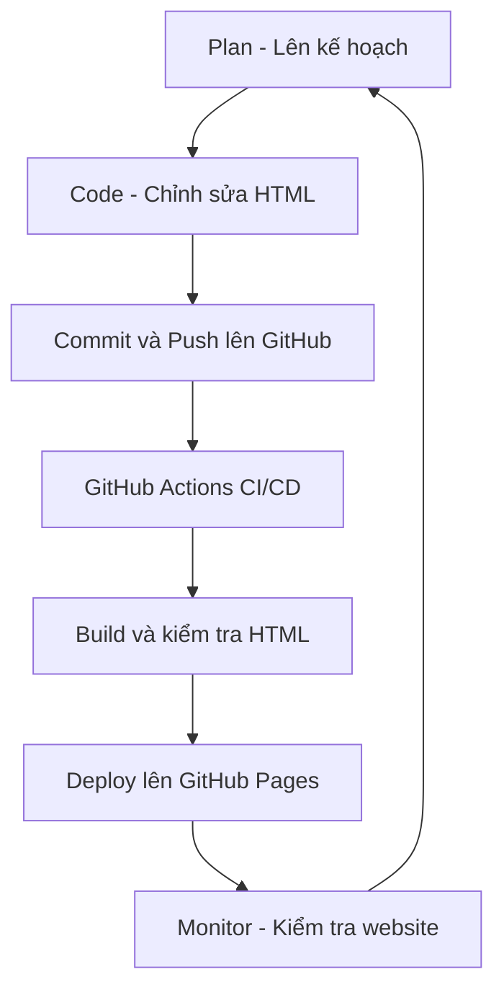

# Báo cáo thực hành Lab 01

## 4.1. So sánh DevOps và truyền thống

| Tiêu chí | Cách THỦ CÔNG (Traditional) | Cách DEVOPS (CI/CD Pipeline) |
|---|---|---|
| Làm sao để deploy? | Upload file và triển khai thủ công | Push code lên GitHub, pipeline tự chạy |
| Mất bao lâu? | Khoảng 15–30 phút (ước tính) | Pipeline: 10 giây, GitHub Pages: 32 giây |
| Ai làm deploy? | Developer hoặc quản trị viên | GitHub Actions tự động |
| Có bị sai sót không? | Dễ xảy ra lỗi do thao tác thủ công | Giảm sai sót nhờ quy trình tự động |
| Rollback nếu lỗi? | Khôi phục thủ công phiên bản cũ | Git revert rồi push để tự động deploy lại |
| Làm sao biết deploy thành công? | Truy cập website kiểm tra thủ công | Kiểm tra trạng thái GitHub Actions và website |

## 4.2. Sơ đồ DevOps Workflow

**Kết quả:** Sau khi commit thay đổi code lên nhánh `main`, GitHub Actions tự động kiểm tra và triển khai website lên GitHub Pages.
